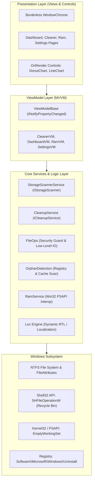

# Pakban Complete Official Documentation
### Version 1.0.0 | .NET 10 & Modern WPF Architecture

---

> [!NOTE]
> This document is the unified, comprehensive official manual for **Pakban**. It encapsulates all architectural details, user guides, OWASP safety models, service API references, and deployment manuals within a single reference document.

---

## Table of Contents

- [1. About, Vision, and Project Goals](#1-about-vision-and-project-goals)
  - [1.1. Introduction to Pakban](#11-introduction-to-pakban)
  - [1.2. Mission and Vision](#12-mission-and-vision)
  - [1.3. Four Core Pillars](#13-four-core-pillars)
  - [1.4. Comparative Analysis with Traditional Tools](#14-comparative-analysis-with-traditional-tools)
- [2. Features, Capabilities, and User Guide](#2-features-capabilities-and-user-guide)
  - [2.1. Navigation and Page Structure](#21-navigation-and-page-structure)
  - [2.2. Overview Dashboard](#22-overview-dashboard)
  - [2.3. Storage Cleaner Engine](#23-storage-cleaner-engine)
  - [2.4. Leftover Application Data Finder](#24-leftover-application-data-finder)
  - [2.5. RAM & Performance Optimization](#25-ram--performance-optimization)
  - [2.6. Settings and Personalization](#26-settings-and-personalization)
  - [2.7. Target Audience & Practical Scenarios](#27-target-audience--practical-scenarios)
- [3. Technical Architecture and System Design](#3-technical-architecture-and-system-design)
  - [3.1. Technology Stack](#31-technology-stack)
  - [3.2. High-Level Architecture Diagram](#32-high-level-architecture-diagram)
  - [3.3. Project Structure and Layer Separation](#33-project-structure-and-layer-separation)
  - [3.4. Modern Window Chrome Engineering](#34-modern-window-chrome-engineering)
  - [3.5. Runtime Localization and Dynamic RTL Architecture](#35-runtime-localization-and-dynamic-rtl-architecture)
  - [3.6. Custom Vector Rendering Controls](#36-custom-vector-rendering-controls)
- [4. Security Model, OWASP Hardening, and Safety Guards](#4-security-model-owasp-hardening-and-safety-guards)
  - [4.1. OWASP Desktop Application Security Standards](#41-owasp-desktop-application-security-standards)
  - [4.2. Path Traversal Defense (CWE-22)](#42-path-traversal-defense-cwe-22)
  - [4.3. Symbolic Link & Junction Point Mitigation (CWE-59)](#43-symbolic-link--junction-point-mitigation-cwe-59)
  - [4.4. Time-of-Check to Time-of-Use (TOCTOU) Defenses](#44-time-of-check-to-time-of-use-toctou-defenses)
  - [4.5. Fault-Tolerant Locked File Handling](#45-fault-tolerant-locked-file-handling)
  - [4.6. Reversible Recycle Bin Safety Model](#46-reversible-recycle-bin-safety-model)
  - [4.7. Privilege Elevation and Least Privilege (UAC)](#47-privilege-elevation-and-least-privilege-uac)
- [5. Core Services and API Reference](#5-core-services-and-api-reference)
  - [5.1. Storage Scanner Service (`IStorageScanner` / `StorageScannerService`)](#51-storage-scanner-service-istoragescanner--storagescannerservice)
  - [5.2. File Cleanup Service (`ICleanupService` / `CleanupService`)](#52-file-cleanup-service-icleanupservice--cleanupservice)
  - [5.3. Low-Level File Operations Guard (`FileOps`)](#53-low-level-file-operations-guard-fileops)
  - [5.4. Orphaned Data Detection (`OrphanDetection`)](#54-orphaned-data-detection-orphandetection)
  - [5.5. Memory Management Service (`RamService`)](#55-memory-management-service-ramservice)
  - [5.6. Logging Service (`LoggingService`)](#56-logging-service-loggingservice)
- [6. Build, Testing, Deployment, and Diagnostics](#6-build-testing-deployment-and-diagnostics)
  - [6.1. Development Prerequisites](#61-development-prerequisites)
  - [6.2. Building via Visual Studio and CLI](#62-building-via-visual-studio-and-cli)
  - [6.3. Headless Pipeline Smoke Test](#63-headless-pipeline-smoke-test)
  - [6.4. Self-Contained Single-File Publishing](#64-self-contained-single-file-publishing)
  - [6.5. Diagnostics and Troubleshooting](#65-diagnostics-and-troubleshooting)

---

## 1. About, Vision, and Project Goals

### 1.1. Introduction to Pakban
**Pakban ("Keeper of Cleanliness")** is an enterprise-grade, blazing-fast, and secure Windows storage management, cleanup, and RAM optimization application developed specifically for **Windows 10 and Windows 11**. Engineered using modern C# on the **.NET 10** platform with the **Windows Presentation Foundation (WPF)** framework, Pakban delivers a state-of-the-art desktop experience.

Throughout everyday computing, gaming sessions, application installations, web browsing, and software development, the Windows operating system silently stockpiles gigabytes of temporary data, obsolete crash logs, browser cache data, update payloads, and abandoned program files—predominantly choking the primary OS partition (`C:`). Traditional system cleanup utilities frequently suffer from cluttered interfaces, bundled bloatware, aggressive system wipes, and broken multilingual layouts. Pakban replaces these flaws with a transparent, hardware-accelerated, vector-drawn environment.

### 1.2. Mission and Vision
The core mission of Pakban is to demystify Windows disk cleanup and performance maintenance, transforming a stressful, high-risk maintenance chore into a transparent, safe, and satisfying user experience. With Pakban, users never need to format or reinstall Windows simply to reclaim disk space.

### 1.3. Four Core Pillars
1. **Absolute Transparency:** Clear, visual breakdown of all disk categories, byte measurements, and file counts with interactive vector graphics.
2. **Uncompromising Safety:** Defense-in-depth protection of critical system directories, non-destructive Recycle Bin routing, and full adherence to OWASP Desktop security guidelines.
3. **Native Stability & Zero External Overhead:** Lightweight execution utilizing WPF and direct Win32 interop with zero bloated external dependencies.
4. **Dynamic Bilingual Experience:** Seamless runtime switching between English (LTR) and Persian (RTL) with dynamic layout mirroring and the bundled Vazirmatn typography.

### 1.4. Comparative Analysis with Traditional Tools
| Criteria | Legacy Cleaners (e.g., CCleaner) | Built-in Disk Cleanup (`cleanmgr`) | Pakban |
| :--- | :--- | :--- | :--- |
| **User Experience (UX)** | Cluttered, confusing, ad-heavy | Outdated legacy UI unchanged since Win7 | Modern, sleek, vector-animated, minimal |
| **Safety Assurance** | Documented history of risky wipes | Very conservative and limited | Hardened against OWASP Desktop (CWE-22, CWE-59) |
| **Leftover Data Detection** | Locked behind paid/Pro tiers | Not supported | Intelligent registry & Start Menu differential scan |
| **RAM Monitoring & Optimization** | Absent or rudimentary | None (Task Manager only) | Live 90s trend line + gentle Working-Set Trim |
| **Bilingual & RTL Support** | Non-existent or broken alignment | Standard Microsoft localization | Seamless dynamic RTL layout + Vazirmatn font |
| **Telemetry & Bloat** | Often bundled with tracking tools | No ads | 100% clean, self-contained, no telemetry |

---

## 2. Features, Capabilities, and User Guide

### 2.1. Navigation and Page Structure
The navigation sidebar provides instant access to 4 core views:
- **Overview (Dashboard):** High-level summary of cleanable storage and memory status.
- **Storage Cleaner:** Deep scan and cleanup across 13 system categories and orphaned folders.
- **RAM & Performance:** Live memory history line chart, circular gauge, and working-set optimizer.
- **Settings:** Language, theme, accent colors, and safety confirmation switches.

### 2.2. Overview Dashboard
- **Smart Metric Cards:** Cleanable space, junk items count, live memory load, and heaviest category.
- **Animated Donut Chart:** Proportional visualization of junk space with interactive hover states.
- **Drive Utilization Monitors:** Live capacity bars for all active mounted partitions.

### 2.3. Storage Cleaner Engine
Pakban categorizes junk data across **13 standard categories**:
1. **User Temp Files (`temp_user`):** Cleans user `%TEMP%` directory; skips active files.
2. **Windows Temp (`temp_windows`):** Wipes legacy OS scratch files inside `%WINDIR%\Temp` (Requires Admin).
3. **Windows Update Cache (`update_cache`):** Clears cached update packages from `%WINDIR%\SoftwareDistribution\Download` (Requires Admin).
4. **Delivery Optimization (`delivery`):** Purges P2P update cache files from Windows Delivery Optimization (Requires Admin).
5. **Recycle Bin (`recycle`):** Empties the Windows Recycle Bin across all drives using `SHEmptyRecycleBinW`.
6. **Thumbnail Cache (`thumbs`):** Deletes corrupted or bloated `*cache_*.db` databases in Windows Explorer.
7. **Browser Caches (`browsers`):** Wipes caches for Google Chrome, Edge, Firefox, Brave, Vivaldi, and Opera across all user profiles.
8. **Shader Caches (`shaders`):** Clears compiled GPU shader caches for DirectX, NVIDIA, AMD, and Intel.
9. **Crash Dumps & WER (`dumps`):** Removes diagnostic crash dumps (`Minidump`) and Windows Error Reporting archives (Requires Admin).
10. **Windows System Logs (`logs`):** Deletes accumulated historical log files in `%WINDIR%\Logs` (Requires Admin).
11. **Prefetch Data (`prefetch`):** Clears stale application pre-caching files in `%WINDIR%\Prefetch` (Requires Admin).
12. **Developer Caches (`dev`):** Cleans package manager caches for Python (`pip`), Node.js (`npm`, `Yarn`), and .NET (`NuGet`).
13. **Previous Windows (`winold`):** Detects legacy `Windows.old` directory and **safely moves it to the Recycle Bin** (Requires Admin).

### 2.4. Leftover Application Data Finder
Pakban scans `AppData` and `ProgramData` against officially installed applications registered in the Windows Registry and Start Menu. Unmatched directories belonging to uninstalled software are flagged as leftover orphans.
> [!IMPORTANT]
> All leftover folders are **routed to the Recycle Bin** via shell APIs, never wiped permanently.

### 2.5. RAM & Performance Optimization
- **Circular Memory Gauge:** Visual percentage of active RAM utilization.
- **90-Second Rolling Line Chart:** Real-time historical trendline of memory usage.
- **Memory Metric Cards:** Total, Used, Available, and Windows System Cache.
- **Top Memory Consumers:** Live list of top RAM-consuming processes.
- **Gentle Working-Set Trim:** Invokes Win32 `EmptyWorkingSet` via `psapi.dll` across processes and executes a garbage collection cycle, reporting net reclaimed space.

### 2.6. Settings and Personalization
- **Runtime Bilingual Switching:** Instant toggling between English (LTR) and Persian (RTL).
- **Dark and Light Themes:** Complete visual system support.
- **6 Accent Colors:** Blue, Cyan, Purple, Emerald, Ruby, and Amber.
- **Safety Confirmation Toggle:** Optional modal dialog confirmation prior to cleaning.

### 2.7. Target Audience & Practical Scenarios
- **Everyday Users:** Freeing space on `C:` without technical complexity.
- **Gamers:** Reclaiming RAM and clearing stale GPU shader caches.
- **Developers:** Wiping multi-gigabyte build and package caches.
- **IT Support:** Rapid, portable, zero-install optimization on client PCs.

---

## 3. Technical Architecture and System Design

### 3.1. Technology Stack
- **Framework:** .NET 10 (`net10.0-windows`) / C# 13/14.
- **UI Engine:** WPF with direct `OnRender` vector drawing.
- **Architecture:** MVVM (`INotifyPropertyChanged`, `RelayCommand`).
- **Interop:** Direct P/Invoke to `psapi.dll`, `shell32.dll`, `kernel32.dll`.
- **Diagnostics:** Serilog with daily-rotating sinks.

### 3.2. High-Level Architecture Diagram



### 3.3. Project Structure and Layer Separation
- `Controls/`: Custom vector controls (`DonutChart`, `LineChart`, `PercentBar`).
- `Localization/`: Core engine (`Loc.cs`), `Flow.cs`, and XAML binding extensions.
- `Models/`: Data structures (`CleanCategory`, `OrphanItem`, `CleanupReport`, `RamStats`).
- `Services/`: File security, storage scanning, cleanup execution, memory trimming, and settings.
- `ViewModels/`: Presentation state coordinators.
- `Views/`: Window and page XAML definitions.
- `Themes/`: Dark and light design resources.

### 3.4. Modern Window Chrome Engineering
Utilizes `System.Windows.Shell.WindowChrome` to deliver a borderless, modern aesthetic while maintaining Aero Snap docking, edge resizing, and double-click maximization.

### 3.5. Runtime Localization and Dynamic RTL Architecture
Binds UI text via dynamic indexers (`Loc.I[key]`). Switching to Persian mirrors the window's `FlowDirection` to `RightToLeft` and applies the bundled **Vazirmatn** font automatically.

### 3.6. Custom Vector Rendering Controls
`DonutChart` and `LineChart` override `OnRender(DrawingContext dc)`. Leveraging `StreamGeometryContext` and frozen brushes (`brush.Freeze()`), graphs render at 60 FPS with near-zero CPU overhead.

---

## 4. Security Model, OWASP Hardening, and Safety Guards

### 4.1. OWASP Desktop Application Security Standards
Pakban follows the official **OWASP Desktop Application Security Project** guidelines to ensure zero accidental system file corruption.

### 4.2. Path Traversal Defense (CWE-22)
- Locks critical system roots in `ProtectedSystemRoots` (Windows, System32, Program Files, User Profile, Desktop, Documents).
- Blocks bare drive roots (`C:\`) and rejects null-byte characters.
- Validates all candidate paths through `FileOps.IsPathSafeForCleanup`.

### 4.3. Symbolic Link & Junction Point Mitigation (CWE-59)
- Inspects NTFS metadata via `File.GetAttributes(path)` without following target paths.
- Skips directory junctions and symbolic links during recursive scans (`AttributesToSkip = FileAttributes.ReparsePoint`).
- Prevents external directory deletion traps.

### 4.4. Time-of-Check to Time-of-Use (TOCTOU) Defenses
Re-checks path safety and file attributes immediately before performing deletion operations.

### 4.5. Fault-Tolerant Locked File Handling
Catches `IOException` and Win32 sharing violations (`ERROR_SHARING_VIOLATION - 32`) gracefully, logging the occurrence and continuing the cleanup pipeline without crashing.

### 4.6. Reversible Recycle Bin Safety Model
Directs sensitive and ambiguous items (uninstalled app data and `Windows.old`) to the Windows Recycle Bin using `SHFileOperationW` (`FOF_ALLOWUNDO`), allowing full user recovery.

### 4.7. Privilege Elevation and Least Privilege (UAC)
Runs unprivileged by default. Administrative actions are badged with a shield icon, and can be elevated via a single-click restart prompt (`runas`).

---

## 5. Core Services and API Reference

### 5.1. Storage Scanner Service (`IStorageScanner` / `StorageScannerService`)
- `IReadOnlyList<DriveInfo> GetAvailableDrives()`: Returns active, ready system drives.
- `Task<StorageScanReport> ScanDrivesAsync(...)`: Performs asynchronous non-blocking storage scans with progress callbacks and cancellation support.

### 5.2. File Cleanup Service (`ICleanupService` / `CleanupService`)
- `Task<CleanupReport> CleanPathsAsync(...)`: Executes safe file deletion pipelines.
- Generates `CleanupReport` detailing freed megabytes, gigabytes, and skip logs.

### 5.3. Low-Level File Operations Guard (`FileOps`)
- `IsPathSafeForCleanup(string? path)`: Path traversal and blacklist validation.
- `IsReparsePoint(string path)`: Checks for symbolic links/junctions.
- `MoveToRecycleBin(string path)`: Sends files to the Recycle Bin.
- `EmptyRecycleBin()`: Purges the Recycle Bin across drives.
- `BuildCategories()`: Returns the 13 standard cleanup category definitions.

### 5.4. Orphaned Data Detection (`OrphanDetection`)
- `Task<List<OrphanItem>> FindAsync(CancellationToken ct)`: Matches registered applications in the registry and Start Menu against directories in `AppData` and `ProgramData`.

### 5.5. Memory Management Service (`RamService`)
- `RamStats GetStats()`: Gathers memory metrics via `GlobalMemoryStatusEx` and `GetPerformanceInfo`.
- `OptimizeResult Optimize()`: Trims process working sets using `EmptyWorkingSet` and triggers a managed garbage collection cycle.

### 5.6. Logging Service (`LoggingService`)
- Manages daily-rotating Serilog files in `%APPDATA%\Pakban\logs\app-yyyyMMdd.log` with a 30-day retention window.
- Hardened against symlink log hijacking (CWE-59).

---

## 6. Build, Testing, Deployment, and Diagnostics

### 6.1. Development Prerequisites
- Windows 10 (1809+) or Windows 11 (x64 / ARM64).
- .NET 10.0 SDK or later.

### 6.2. Building via Visual Studio and CLI
```powershell
# Build in Release mode
dotnet build Pakban.sln -c Release

# Run the compiled binary
.\bin\Release\net10.0-windows\Pakban.exe
```

### 6.3. Headless Pipeline Smoke Test
```powershell
.\bin\Release\net10.0-windows\Pakban.exe --selftest-scan
```
Executes a headless smoke test of the entire scanning pipeline and writes results to `selftest.log`.

### 6.4. Self-Contained Single-File Publishing
```powershell
dotnet publish Pakban.csproj `
    -c Release `
    -r win-x64 `
    --self-contained true `
    /p:PublishSingleFile=true `
    /p:EnableCompressionInSingleFile=true
```
Generates a standalone portable executable at `bin\Release\net10.0-windows\win-x64\publish\Pakban.exe`.

### 6.5. Diagnostics and Troubleshooting
Log files and runtime events are stored at:
```
%APPDATA%\Pakban\logs\app-yyyyMMdd.log
```
Application preferences are persisted in `%APPDATA%\Pakban\settings.json`.
