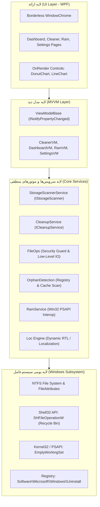

# مستندات جامع و راهنمای رسمی نرم‌افزار پاکبان (Pakban)
### نگارش ۱.۰.۰ | مبتنی بر دات‌نت ۱۰ (.NET 10) و معماری مدرن WPF

---

> [!NOTE]
> این سند، کتابچه جامع و رسمی نرم‌افزار **پاکبان (Pakban)** است که تمام ابعاد پروژه شامل چرایی و اهداف، راهنمای کاربری ماژول‌ها، معماری نرم‌افزار، استانداردهای امنیتی، مرجع سرویس‌ها و کدهای پایه، و راهنمای بیلد و استقرار را در یک فایل یکپارچه در بر می‌گیرد.

---

## فهرست مطالب

- [۱. درباره پروژه، چشم‌انداز و اهداف](#۱-درباره-پروژه-چشمانداز-و-اهداف)
  - [۱.۱. معرفی نرم‌افزار](#۱۱-معرفی-نرمافزار)
  - [۱.۲. رسالت و چشم‌انداز](#۱۲-رسالت-و-چشمانداز)
  - [۱.۳. اهداف کلیدی ۴گانه](#۱۳-اهداف-کلیدی-۴گانه)
  - [۱.۴. جدول مقایسه‌ای با راهکارهای سنتی](#۱۴-جدول-مقایسهای-با-راهکارهای-سنتی)
- [۲. قابلیت‌ها، امکانات و راهنمای کاربری](#۲-قابلیتها-امکانات-و-راهنمای-کاربری)
  - [۲.۱. ساختار ناوبری و صفحات برنامه](#۲۱-ساختار-ناوبری-و-صفحات-برنامه)
  - [۲.۲. پیشخوان تحلیلی (Overview / Dashboard)](#۲۲-پیشخوان-تحلیلی-overview--dashboard)
  - [۲.۳. پاک‌ساز فضای ذخیره‌سازی (Storage Cleaner)](#۲۳-پاکساز-فضای-ذخیرهسازی-storage-cleaner)
  - [۲.۴. ماژول شناسایی داده‌های بازمانده (Leftover Finder)](#۲۴-ماژول-شناسایی-دادههای-بازمانده-leftover-finder)
  - [۲.۵. پایش و بهینه‌سازی رم (RAM & Performance)](#۲۵-پایش-و-بهینهسازی-رم-ram--performance)
  - [۲.۶. تنظیمات و شخصی‌سازی (Settings)](#۲۶-تنظیمات-و-شخصیسازی-settings)
  - [۲.۷. جامعه مخاطبان و سناریوهای کاربردی](#۲۷-جامعه-مخاطبان-و-سناریوهای-کاربردی)
- [۳. معماری فنی و طراحی مهندسی سیستم](#۳-معماری-فنی-و-طراحی-مهندسی-سیستم)
  - [۳.۱. پشته فناوری (Technology Stack)](#۳۱-پشته-فناوری-technology-stack)
  - [۳.۲. نمودار معماری کلان نرم‌افزار](#۳۲-نمودار-معماری-کلان-نرمافزار)
  - [۳.۳. ساختار درختی پروژه و تفکیک لایه‌ها](#۳۳-ساختار-درختی-پروژه-و-تفکیک-لایهها)
  - [۳.۴. مهندسی رابط کاربری و پنجره بدون حاشیه (WindowChrome)](#۳۴-مهندسی-رابط-کاربری-و-پنجره-بدون-حاشیه-windowchrome)
  - [۳.۵. معماری محلی‌سازی و RTL بلادرنگ](#۳۵-معماری-محلیسازی-و-rtl-بلادرنگ)
  - [۳.۶. کنترل‌های برداری سفارشی (Custom Direct Rendering)](#۳۶-کنترلهای-برداری-سفارشی-custom-direct-rendering)
- [۴. مدل امنیت، استانداردها و مکانیزم‌های حفاظتی](#۴-مدل-امنیت-استانداردها-و-مکانیزمهای-حفاظتی)
  - [۴.۱. استانداردهای امنیتی OWASP Desktop](#۴۱-استانداردهای-امنیتی-owasp-desktop)
  - [۴.۲. مقابله با پیمایش غیرمجاز مسیر (CWE-22: Path Traversal)](#۴۲-مقابله-با-پیمایش-غیرمجاز-مسیر-cwe-22-path-traversal)
  - [۴.۳. مقابله با حملات لینک‌های نمادین و جانکشن‌ها (CWE-59: Reparse Points)](#۴۳-مقابله-با-حملات-لینکهای-نمادین-و-جانکشنها-cwe-59-reparse-points)
  - [۴.۴. شرایط رقابتی زمان بررسی تا استفاده (TOCTOU Race Conditions)](#۴۴-شرایط-رقابتی-زمان-بررسی-تا-استفاده-toctou-race-conditions)
  - [۴.۵. مدیریت هوشمند فایل‌های قفل‌شده (Locked Files & Sharing Violations)](#۴۵-مدیریت-هوشمند-فایلهای-قفلشده-locked-files--sharing-violations)
  - [۴.۶. مدل ایمنی سطل زباله بازگشت‌پذیر (Recycle Bin Safety Model)](#۴۶-مدل-ایمنی-سطل-زباله-بازگشتپذیر-recycle-bin-safety-model)
  - [۴.۷. تفکیک سطوح دسترسی و UAC (Elevation)](#۴۷-تفکیک-سطوح-دسترسی-و-uac-elevation)
- [۵. مرجع فنی سرویس‌ها و APIهای هسته](#۵-مرجع-فنی-سرویسها-و-apiهای-هسته)
  - [۵.۱. سرویس پویش دیسک (`IStorageScanner` / `StorageScannerService`)](#۵۱-سرویس-پویش-دیسک-istoragescanner--storagescannerservice)
  - [۵.۲. سرویس پاکسازی (`ICleanupService` / `CleanupService`)](#۵۲-سرویس-پاکسازی-icleanupservice--cleanupservice)
  - [۵.۳. کتابخانه عملیات فایل و گارد حفاظتی (`FileOps`)](#۵۳-کتابخانه-عملیات-فایل-و-گارد-حفاظتی-fileops)
  - [۵.۴. سرویس ردیابی داده‌های بازمانده (`OrphanDetection`)](#۵۴-سرویس-ردیابی-دادههای-بازمانده-orphandetection)
  - [۵.۵. سرویس مدیریت رم (`RamService`)](#۵۵-سرویس-مدیریت-رم-ramservice)
  - [۵.۶. سرویس ثبت ساختاریافته وقایع (`LoggingService`)](#۵۶-سرویس-ثبت-ساختاریافته-وقایع-loggingservice)
- [۶. راهنمای بیلد، آزمون و استقرار](#۶-راهنمای-بیلد-آزمون-و-استقرار)
  - [۶.۱. نیازمندی‌های سیستمی](#۶۱-نیازمندیهای-سیستمی)
  - [۶.۲. نحوه کامپایل در ویژوال استودیو و CLI](#۶۲-نحوه-کامپایل-در-ویژوال-استودیو-و-cli)
  - [۶.۳. آزمون خودکار پایپلاین اسکن بدون واسط کاربری (Headless Test)](#۶۳-آزمون-خودکار-پایپلاین-اسکن-بدون-واسط-کاربری-headless-test)
  - [۶.۴. ساخت بسته اجرایی مستقل و بدون وابستگی (Single-File Publish)](#۶۴-ساخت-بسته-اجرایی-مستقل-و-بدون-وابستگی-single-file-publish)
  - [۶.۵. خطایابی و تحلیل فایل‌های لاگ](#۶۵-خطایابی-و-تحلیل-فایلهای-لاگ)

---

## ۱. درباره پروژه، چشم‌انداز و اهداف

### ۱.۱. معرفی نرم‌افزار
**پاکبان (Pakban)** نرم‌افزاری مدرن، سریع، چشم‌نواز و فوق‌العاده امن برای مدیریت و پاکسازی دیسک و بهینه‌سازی حافظه رم در سیستم‌عامل ویندوز (Windows 10/11) است. این نرم‌افزار با بهره‌گیری از آخرین امکانات زبان برنامه‌نویسی C# بر روی پلتفرم قدرتمند .NET 10 و فریم‌ورک استاندارد WPF توسعه داده شده است.

در طول استفاده مداوم از ویندوز، اجرای نرم‌افزارها، مرور وب، کامپایل پروژه‌ها و دانلود آپدیت‌ها، گیگابایت‌ها داده‌های موقت، گزارش‌های خطای تکراری و بقایای نرم‌افزارهای حذف شده روی حافظه دیسک انباشته می‌شوند. ابزارهای قدیمی اغلب کند، ناامن، پر از تبلیغات و فاقد واسط کاربری سازگار با زبان‌های راست‌چین هستند. پاکبان با طراحی کاملاً اختصاصی و بدون هیچ‌گونه تبلیغ یا ابزار جانبی، تجربه‌ای لذت‌بخش و ایمن را به کاربر هدیه می‌دهد.

### ۱.۲. رسالت و چشم‌انداز
رسالت پاکبان این است که بدون نیاز به داشتن دانش تخصصی سخت‌افزار یا سیستم‌عامل، و بدون نیاز به فرمت و نصب مجدد ویندوز، هر کاربری بتواند تنها با چند کلیک ساده فضای اشغال‌شده سیستم خود را بازپس‌گیرد و سرعت و کارایی سیستم را ارتقا بخشد.

### ۱.۳. اهداف کلیدی ۴گانه
1. **شفافیت (Transparency):** کاربر باید به صورت بصری و آماری دقیقاً بداند کدام بخش از سیستم چه میزان فضا اشغال کرده است.
2. **امنیت بی‌قیدوشرط (Safety):** محافظت سرسختانه از سیستم‌عامل و پرونده‌های کاربر در برابر پاکسازی اشتباه؛ انتقال داده‌های ریسکی به سطل بازیافت.
3. **پایداری و سبکی بومی (Native Performance):** عدم وابستگی به ابزارها و پکیج‌های حجیم سنگین‌کننده، رندرینگ برداری با شتاب‌دهنده گرافیکی سخت‌افزاری و اجرای سریع پردازش‌ها به صورت کاملاً ناهمگام (Async).
4. **طراحی دوزبانه بومی (Bilingual Support):** پشتیبانی کامل و استاندارد از زبان فارسی با چیدمان اصولی راست‌به‌چپ (RTL) و فونت اصلاح‌شده وزیرمتن در کنار زبان انگلیسی چپ‌به‌راست (LTR).

### ۱.۴. جدول مقایسه‌ای با راهکارهای سنتی
| شاخص | نرم‌افزارهای سنتی (مانند CCleaner) | ابزار داخلی ویندوز (Cleanmgr) | نرم‌افزار پاکبان (Pakban) |
| :--- | :--- | :--- | :--- |
| **واسط کاربری** | شلوغ، تجاری، کند و همراه با تبلیغات | بسیار قدیمی و با امکانات محدود | مدرن، سبک، شیک، برداری و انیمیشنی |
| **ایمنی در برابر حملات** | سابقه گزارش آسیب‌پذیری‌های امنیتی | محافظه‌کارانه | رعایت استانداردهای OWASP Desktop (CWE-22, CWE-59) |
| **داده‌های بازمانده (Leftovers)**| فقط در نسخه‌های غیررایگان | ندارد | اسکن هوشمند با تحلیل رجیستری و منوی استارت |
| **پایش و سبک‌سازی رم** | فاقد گراف لحظه‌ای یا ناقص | ندارد | گراف لحظه‌ای ۹۰ ثانیه‌ای + Working-Set Trim استاندارد |
| **پشتیبانی فارسی و RTL** | ندارد یا بسیار ناقص | ناقص | پشتیبانی کامل بلادرنگ با تایپوگرافی اختصاصی Vazirmatn |

---

## ۲. قابلیت‌ها، امکانات و راهنمای کاربری

### ۲.۱. ساختار ناوبری و صفحات برنامه
رابط کاربری پاکبان از طریق یک نوار کناری مینیمال و ارگونومیک، دسترسی به ۴ بخش اصلی را مهیا می‌کند:
- **پیشخوان (Dashboard):** بررسی آماری سریع و سلامت کلی سیستم.
- **پاک‌ساز فضای ذخیره‌سازی (Cleaner):** موتور جامع اسکن و پاکسازی دیسک.
- **رم و عملکرد (RAM):** پایش مداوم و سبک‌سازی حافظه موقت.
- **تنظیمات (Settings):** مدیریت زبان، پوسته‌ها، رنگ‌ها و ترجیحات امنیتی.

### ۲.۲. پیشخوان تحلیلی (Overview / Dashboard)
- **کارت‌های آماری هوشمند:** نمایش حجم کل زباله‌ها به گیگابایت، تعداد فایل‌ها، میزان درصد فشار رم و بزرگ‌ترین مصرف‌کننده فضا.
- **نمودار انیمیشنی دونات (Animated Donut Chart):** نمایش سهم هر گروه زباله از فضای اشغال‌شده همراه با هایلایت شناور روی قطاع‌ها با تکان دادن ماوس.
- **نوار پایش درایوها:** درصد فضای پر و خالی تمام هارد دیسک‌ها و SSDهای متصل به سیستم.

### ۲.۳. پاک‌ساز فضای ذخیره‌سازی (Storage Cleaner)
موتور پاکسازی پاکبان ۱۳ دسته‌بندی مختلف سیستم را تفکیک می‌کند:
1. **فایل‌های موقت کاربر (`temp_user`):** تخلیه پوشه `%TEMP%` کاربر با رد فایل‌های در حال پردازش.
2. **فایل‌های موقت ویندوز (`temp_windows`):** پاکسازی شاخه `%WINDIR%\Temp` (نیاز به ادمین).
3. **کش آپدیت ویندوز (`update_cache`):** حذف بسته‌های نصب‌شده آپدیت در `SoftwareDistribution\Download` (نیاز به ادمین).
4. **کش بهینه‌سازی تحویل (`delivery`):** تخلیه دیتای Delivery Optimization ویندوز در شبکه محلی (نیاز به ادمین).
5. **سطل زباله ویندوز (`recycle`):** پاکسازی امن Recycle Bin تمامی درایوها با متد بومی Win32.
6. **کش تصاویر بندانگشتی (`thumbs`):** حذف فایل‌های دیتابیس تامبنیل اکسپلورر جهت آزادسازی فضا و رفع باگ‌های نمایش تصاویر.
7. **کش مرورگرهای وب (`browsers`):** پاکسازی کامل کش مرورگرهای گوگل کروم، مایکروسافت اج، موزیلا فایرفاکس، بریو، ویوالدی و اپرا در تمامی پروفایل‌ها.
8. **کش سایه‌زن‌های گرافیکی (`shaders`):** تخلیه فایل‌های موقت شیدر کارت‌های گرافیک DirectX, NVIDIA, AMD, Intel.
9. **دامپ‌های کرش و خطا (`dumps`):** حذف فایل‌های اشکال‌زدایی Minidump و Windows Error Reporting (نیاز به ادمین).
10. **لاگ‌های ویندوز (`logs`):** پاکسازی فایل‌های لاگ گزارش‌گیری در شاخه `Windows\Logs` (نیاز به ادمین).
11. **پیش‌بارگذاری برنامه‌ها (`prefetch`):** پاکسازی دایرکتوری Prefetch سیستم‌عامل (نیاز به ادمین).
12. **کش ابزارهای توسعه‌دهندگان (`dev`):** پاکسازی کش پکیج‌منیجرهای پایتون (pip)، نودجی‌اس (npm/yarn) و دات‌نت (NuGet).
13. **نسخه قبلی ویندوز (`winold`):** انتقال ایمن پوشه `Windows.old` به سطل زباله جهت محافظت از بازیابی احتمالی (نیاز به ادمین).

### ۲.۴. ماژول شناسایی داده‌های بازمانده (Leftover Finder)
برنامه‌ها پس از حذف شدن، پوشه‌های پیکربندی یا داده‌های حجیم خود را در مسیرهای `AppData` و `ProgramData` رها می‌کنند. پاکبان با پیمایش همزمان رجیستری نرم‌افزارهای نصب‌شده و شورت‌کات‌های معتبر منوی استارت، این پوشه‌های یتیم (Orphan) را شناسایی می‌کند.
> [!IMPORTANT]
> پوشه‌های بازمانده **همیشه به سطل زباله (Recycle Bin)** منتقل می‌شوند تا کاربر بدون هیچ ترسی از دست رفتن دائمی اطلاعات، سیستم را سبک کند.

### ۲.۵. پایش و بهینه‌سازی رم (RAM & Performance)
- **گیج دایره‌ای مصرف رم:** نمایش دقیق مصرف زنده رم به درصد و گیگابایت.
- **نمودار خطی ۹۰ ثانیه‌ای:** ثبت و نمایش تاریخچه نوسانات مصرف رم با انیمیشن یکنواخت.
- **کارت‌های ۴گانه حافظه:** نمایش کل حافظه فیزیکی، مقدار مصرف‌شده، مقدار آزاد و حجم کش سیستمی (System Cache).
- **پایش برنامه‌های پرمصرف:** نمایش ۱۰ پروسه فعال که بیشترین رم را مصرف می‌کنند به همراه نوار متناسب.
- **بهینه‌ساز ملایم رم (Working Set Trim):** اجرای تابع `EmptyWorkingSet` بر روی پردازه‌های در دسترس و انجام فرآیند پاکسازی حافظه با GC دات‌نت؛ با اعلام دقیق و صادقانه میزان رم بازپس‌گرفته‌شده به مگابایت.

### ۲.۶. تنظیمات و شخصی‌سازی (Settings)
- **سوئیچینگ زبان در لحظه:** تعویض آسان میان زبان فارسی و انگلیسی همراه با معکوس‌سازی جهت گرافیکی رابط کاربری.
- **تم‌های تاریک و روشن (Dark / Light):** متناسب با شرایط نوری محیط.
- **۶ پالت رنگی اختصاصی (Accent Colors):** شامل رنگ‌های مدرن آبی، ارغوانی، فیروزه‌ای، زمردی و غیره.
- **کلید تایید قبل از پاکسازی:** جلوگیری از اجرای ناخواسته عملیات پاکسازی با نمایش دیالوگ تاییدیه.

### ۲.۷. جامعه مخاطبان و سناریوهای کاربردی
- **کاربران خانگی و اداری:** باز کردن فوری فضای درایو C و بهبود سرعت کلی سیستم.
- **گیمرها:** بهینه‌سازی رم قبل از شروع بازی‌های سنگین و حذف کش‌های گرافیکی حجیم و آپدیت‌های منسوخ.
- **برنامه‌نویسان و مهندسان نرم‌افزار:** حذف ده‌ها گیگابایت کش بیلد و پکیج‌های ابزارهای توسعه.
- **تکنسین‌های IT:** به عنوان ابزاری سبک و بدون نیاز به نصب جهت پشتیبانی و نگهداری کلاینت‌ها.

---

## ۳. معماری فنی و طراحی مهندسی سیستم

### ۳.۱. پشته فناوری
- **پلتفرم اجرایی:** .NET 10.0 (net10.0-windows) با بهره‌گیری از آخرین قابلیت‌های C# 13/14.
- **موتور ارائه رابط کاربری:** WPF با Direct Drawing و شتاب‌دهنده سخت‌افزاری گرافیکی.
- **الگوی ساختار:** MVVM (جداسازی قاطع Logic از View).
- **واسط‌های محلی سیستم‌عامل (P/Invoke):** ارتباط مستقیم با توابع بومی Win32 APIs برای حداکثر سرعت.
- **موتور ثبت وقایع:** Serilog با ساختار فایل‌های چرخشی روزانه.

### ۳.۲. نمودار معماری کلان نرم‌افزار



### ۳.۳. ساختار درختی پروژه و تفکیک لایه‌ها
معماری پروژه پاکبان به صورت منظم سازمان‌دهی شده است:
- `Controls/`: کنترل‌های اختصاصی رندرینگ گرافیکی (دونات چارت، لاین چارت، نوار درصد).
- `Localization/`: کلاس‌های `Loc.cs`، مدیریت چیدمان راست‌به‌چپ `Flow.cs` و تبدیل‌کننده‌های XAML.
- `Models/`: مدل‌های انتزاعی نظیر `CleanCategory`, `OrphanItem`, `CleanupReport`, `RamStats`.
- `Services/`: هسته پردازش دیسک، رم، امنیت مسیرها، عملیات شل و تنظیمات.
- `ViewModels/`: کلاس‌های منطق ناوبری و هماهنگ‌کننده داده‌های صفحات.
- `Views/`: پنجره اصلی و صفحات XAML رابط کاربری.
- `Themes/`: پوسته‌های تاریک و روشن و پالت‌های رنگی.

### ۳.۴. مهندسی رابط کاربری و پنجره بدون حاشیه (WindowChrome)
برای ایجاد ظاهری مدرن و مدرن‌سازی نوار عنوان (Title Bar) سنتی ویندوز بدون از دست رفتن قابلیت‌های حیاتی دسکتاپ نظیر Aero Snap، تغییر اندازه از لبه‌ها و منوی سیستمی، از ساختار `WindowChrome` استفاده شده است. دکمه‌های بستن، ماکسیمایز و مینیمایز با استایل‌های وکتوری سفارشی طراحی شده‌اند.

### ۳.۵. معماری محلی‌سازی و RTL بلادرنگ
سیستم محلی‌سازی بدون نیاز به فایل‌های پیچیده `.resx` کار می‌کند. یک دیکشنری متمرکز کلید-مقدار در کلاس `Loc.cs` قرار دارد. ویژگی‌های XAML از طریق Indexer به این کلاس متصل هستند. با فشردن دکمه تغییر زبان، با اطلاع‌رسانی به `Binding.IndexerName` و اصلاح ویژگی `FlowDirection`، چیدمان کل پنجره به صورت آینه‌ای راست‌به‌چپ تغییر یافته و فونت اصلاح‌شده وزیرمتن فراخوانی می‌شود.

### ۳.۶. کنترل‌های برداری سفارشی (Custom Direct Rendering)
کنترل‌های نمودار دونات (`DonutChart`) و نمودار خطی (`LineChart`) به جای استفاده از بسته‌های سنگین خارجی، متد `OnRender` را با استفاده از `DrawingContext` بازنویسی کرده‌اند. استفاده از ریاضیات مثلثاتی مستقیم برای قطاع‌های دایره و انجماد براش‌ها (`brush.Freeze()`) موجب می‌شود مصرف پردازنده حتی در سنگین‌ترین انیمیشن‌ها نزدیک به صفر باقی بماند.

---

## ۴. مدل امنیت، استانداردها و مکانیزم‌های حفاظتی

### ۴.۱. استانداردهای امنیتی OWASP Desktop
عملیات دستکاری و حذف فایل‌ها در پاکبان بر اساس دستورالعمل‌های رسمی **OWASP Desktop Application Security Project** توسعه داده شده است.

### ۴.۲. مقابله با پیمایش غیرمجاز مسیر (CWE-22: Path Traversal)
- لیست سیاه ریشه‌های حساس سیستم (`ProtectedSystemRoots`) شامل شاخه‌های ویندوز، System32، فایل‌های برنامه‌ها و پروفایل کاربری در حافظه قفل شده است.
- مسدودسازی کاراکترهای Null (`\0`) و جلوگیری از حذف ریشه مستقیم هر درایوی (نظیر `C:\`).
- کلیه مسیرها پیش از هرگونه اقدام توسط متد سخت‌گیرانه `FileOps.IsPathSafeForCleanup` بازبینی و اعتبارسنجی می‌شوند.

### ۴.۳. مقابله با حملات لینک‌های نمادین و جانکشن‌ها (CWE-59: Reparse Points)
یکی از جدی‌ترین آسیب‌پذیری‌های نرم‌افزارهای تمیزکننده، ورود ناخواسته به Symbolic Links و Directory Junctions است. اگر لینکی در پوشه Temp به دایرکتوری سیستمی اشاره داشته باشد، پیمایش آن باعث تخریب سیستم خواهد شد.
- پاکبان با استعلام متادیتای NTFS از طریق `File.GetAttributes(path)` و بررسی پرچم `FileAttributes.ReparsePoint`، وجود لینک‌های نمادین را در متد `FileOps.IsReparsePoint` کشف می‌کند.
- در کلاس `StorageScannerService`، آپشن `AttributesToSkip = FileAttributes.ReparsePoint` تعیین شده تا پیمایش بازگشتی دیسک هرگز به درون لینک‌ها نفوذ نکند.

### ۴.۴. شرایط رقابتی زمان بررسی تا استفاده (TOCTOU Race Conditions)
بین زمان اسکن و زمان اجرای حذف، ساختار فایل‌ها مجدداً مورد اعتبارسنجی آنی قرار می‌گیرد تا اطمینان حاصل شود که هیچ تغییری در ماهیت آیتم‌ها ایجاد نشده است.

### ۴.۵. مدیریت هوشمند فایل‌های قفل‌شده (Locked Files & Sharing Violations)
در زمان پاکسازی، برخی فایل‌ها توسط فرآیندهای دیگر در حال استفاده هستند. پاکبان تمامی خطاهای ناشی از قفل بودن فایل (`Sharing Violation - Error 32`) و خطاهای دسترسی را در بلوک‌های محافظت‌شده مهار می‌کند؛ فایل قفل‌شده بدون متوقف کردن فرآیند پاکسازی نادیده گرفته شده و در لاگ ثبت می‌گردد.

### ۴.۶. مدل ایمنی سطل زباله بازگشت‌پذیر (Recycle Bin Safety Model)
پاکبان برای داده‌های با درجه حساسیت متوسط و بالا (مانند بقایای نرم‌افزارهای حذف شده و `Windows.old`) از دستور حذف قطعی استفاده نمی‌کند، بلکه با بهره‌گیری از فراخوانی Win32 Shell API:
```csharp
SHFileOperation(ref shf); // با پرچم FOF_ALLOWUNDO
```
آیتم‌ها را مستقیماً به سطل بازیافت ویندوز ارسال می‌کند تا کاربر قابلیت بازگردانی (Undo) کامل داشته باشد.

### ۴.۷. تفکیک سطوح دسترسی و UAC (Elevation)
پاکبان بر اساس اصل کمترین امتیاز (Least Privilege) برای عملکرد عمومی خود نیازی به دسترسی ادمین ندارد. بخش‌هایی که به دسترسی سطح بالا نیاز دارند با یک نشانگر قفل متمایز شده و کاربر می‌تواند در صورت تمایل، با یک کلیک برنامه را با دسترسی Administrator بازراه‌اندازی نماید.

---

## ۵. مرجع فنی سرویس‌ها و APIهای هسته

### ۵.۱. سرویس پویش دیسک (`IStorageScanner` / `StorageScannerService`)
قرارداد استاندارد اسکن هوشمند درایوها:
- `IReadOnlyList<DriveInfo> GetAvailableDrives()`: استخراج درایوهای فیزیکی آماده و بدون خطای سیستم.
- `Task<StorageScanReport> ScanDrivesAsync(...)`: اجرای اسکن ناهمگام با گزارش مداوم درصد پیشرفت (`StorageScanProgress`) و قابلیت لغو عملیات با `CancellationToken`.

### ۵.۲. سرویس پاکسازی (`ICleanupService` / `CleanupService`)
مدیریت عملیات پاکسازی و بازیافت:
- `Task<CleanupReport> CleanPathsAsync(...)`: اجرای عملیات حذف روی لیستی از مسیرها.
- بازگرداندن شیء گزارش جامع `CleanupReport` شامل حجم آزادشده به مگابایت و گیگابایت، تعداد فایل‌های حذف‌شده و لیست موارد شکست‌خورده با ذکر علت قفل بودن فایل.

### ۵.۳. کتابخانه عملیات فایل و گارد حفاظتی (`FileOps`)
- `IsPathSafeForCleanup(string? path)`: اعتبارسنجی امنیتی مسیر.
- `IsReparsePoint(string path)`: تشخیص فوری لینک نمادین یا جانکشن دایرکتوری.
- `MoveToRecycleBin(string path)`: انتقال امن فایل به سطل زباله بدون دیالوگ مزاحم.
- `EmptyRecycleBin()`: تخلیه قطعی سطل زباله.
- `BuildCategories()`: تولید و تنظیم ۱۳ دسته‌بندی پیش‌فرض پاکسازی.

### ۵.۴. سرویس ردیابی داده‌های بازمانده (`OrphanDetection`)
- `Task<List<OrphanItem>> FindAsync(CancellationToken ct)`: اسکن رجیستری ویندوز برای استخراج نام برنامه‌های واقعاً نصب‌شده و تطبیق آن‌ها با پوشه‌های رها شده در `%LOCALAPPDATA%`, `%APPDATA%` و `%PROGRAMDATA%`.

### ۵.۵. سرویس مدیریت رم (`RamService`)
- `RamStats GetStats()`: فراخوانی توابع `GlobalMemoryStatusEx` و `GetPerformanceInfo` جهت محاسبه دقیق رم کل، مصرفی، آزاد و کش سیستمی.
- `OptimizeResult Optimize()`: اجرای Working-Set Trim روی پردازه‌های سیستم از طریق `EmptyWorkingSet` از `psapi.dll` و آزادسازی حافظه موقت با Garbage Collection.

### ۵.۶. سرویس ثبت ساختاریافته وقایع (`LoggingService`)
- پیکربندی **Serilog** جهت ایجاد فایل‌های لاگ روزانه در مسیر `%APPDATA%\Pakban\logs\app-yyyyMMdd.log`.
- نگهداری خودکار فایل‌های ۳۰ روز اخیر.
- محافظت از فایل‌های لاگ در برابر حملات Symlink Arbitrary File Write (CWE-59).

---

## ۶. راهنمای بیلد، آزمون و استقرار

### ۶.۱. نیازمندی‌های سیستمی
- ویندوز ۱۰ نسخه ۱۸۰۹ به بالا یا ویندوز ۱۱ (پشتیبانی از x64 و ARM64).
- نصب بودن .NET 10.0 SDK برای کامپایل پروژه.

### ۶.۲. نحوه کامپایل در ویژوال استودیو و CLI
```powershell
# کامپایل پروژه با پیکربندی ریلیز
dotnet build Pakban.sln -c Release

# اجرای برنامه
.\bin\Release\net10.0-windows\Pakban.exe
```

### ۶.۳. آزمون خودکار پایپلاین اسکن بدون واسط کاربری (Headless Test)
برای بررسی عملکرد موتور اسکن دیسک بدون باز شدن رابط گرافیکی:
```powershell
.\bin\Release\net10.0-windows\Pakban.exe --selftest-scan
```
گزارش کامل اجرای اسکن در فایل `selftest.log` در کنار فایل اجرایی ثبت می‌گردد.

### ۶.۴. ساخت بسته اجرایی مستقل و بدون وابستگی (Single-File Publish)
برای ایجاد یک فایل `.exe` منفرد که روی سیستم کاربران بدون نیاز به نصب هیچ پیش‌نیازی اجرا شود:
```powershell
dotnet publish Pakban.csproj `
    -c Release `
    -r win-x64 `
    --self-contained true `
    /p:PublishSingleFile=true `
    /p:EnableCompressionInSingleFile=true
```
فایل خروجی نهایی با نام `Pakban.exe` در مسیر `bin\Release\net10.0-windows\win-x64\publish\` تولید می‌گردد.

### ۶.۵. خطایابی و تحلیل فایل‌های لاگ
در صورت گزارش مشکل توسط کاربران، کلیه رخدادها، مسیرهای رد شده و استثناها در مسیر زیر قابل دسترسی و پیگیری هستند:
```
%APPDATA%\Pakban\logs\app-yyyyMMdd.log
```
