# مستندات رسمی پاکبان (Pakban Documentation Hub)

به مرکز مستندات رسمی نرم‌افزار **پاکبان (Pakban)** خوش آمدید.  
پاکبان، ابزار مدرن، هوشمند و فوق‌العاده امن مدیریت حافظه و بهینه‌سازی دیسک و رم برای سیستم‌عامل ویندوز (Windows 10 / 11) است که با استفاده از تکنولوژی مدرن **C# / WPF بر بستر دات‌نت 10 (.NET 10)** توسعه یافته است.

---

## 📚 فهرست مستندات (Documentation Index)

مستندات به دو زبان فارسی و انگلیسی به صورت تفکیک‌شده و همچنین به صورت مستند جامع یکپارچه در دسترس قرار دارند:

### 🇮🇷 مستندات رسمی به زبان فارسی (Persian Documentation)
- **[مستند جامع و یکپارچه رسمی پاکبان (DOCUMENTATION_FA.md)](./DOCUMENTATION_FA.md)** — کتابچه کامل راهنما و مستندات فنی و کاربری در یک فایل واحد.
- **بخش‌های تفکیک‌شده:**
  1. [درباره پروژه، چشم‌انداز و اهداف](./fa/01_about_and_vision.md)
  2. [قابلیت‌ها، ویژگی‌ها و کاربردها](./fa/02_features_and_usecases.md)
  3. [معماری فنی و طراحی سیستم](./fa/03_technical_architecture.md)
  4. [مدل امنیت، استاندارد OWASP و مکانیزم‌های حفاظتی](./fa/04_security_and_protection.md)
  5. [مرجع سرویس‌ها و کدهای هسته (API Reference)](./fa/05_services_and_api.md)
  6. [راهنمای بیلد، تست، استقرار و عیب‌یابی](./fa/06_build_and_deployment.md)

---

### 🇬🇧 Official English Documentation
- **[Pakban Complete Official Documentation (DOCUMENTATION_EN.md)](./DOCUMENTATION_EN.md)** — The full unified technical and user manual in a single comprehensive file.
- **Modular Chapters:**
  1. [About, Vision, and Project Goals](./en/01_about_and_vision.md)
  2. [Features, Capabilities, and Use Cases](./en/02_features_and_usecases.md)
  3. [Technical Architecture and System Design](./en/03_technical_architecture.md)
  4. [Security Model, OWASP Hardening, and Safety Guards](./en/04_security_and_protection.md)
  5. [Services and Core API Reference](./en/05_services_and_api.md)
  6. [Build, Testing, Deployment, and Diagnostics](./en/06_build_and_deployment.md)

---

## 🧭 نقشه راه دسترسی سریع (Quick Navigation)

```mermaid
flowchart TD
    Hub["مرکز مستندات پاکبان (Docs Hub)"]
    
    subgraph FA ["مستندات فارسی (FA)"]
        FA_Full["مستند جامع یکپارچه (DOCUMENTATION_FA.md)"]
        FA_1["01. معرفی و اهداف"]
        FA_2["02. قابلیت‌ها و کاربردها"]
        FA_3["03. معماری فنی"]
        FA_4["04. امنیت و استانداردها"]
        FA_5["05. مرجع API و سرویس‌ها"]
        FA_6["06. بیلد و استقرار"]
    end

    subgraph EN ["English Documentation (EN)"]
        EN_Full["Complete Manual (DOCUMENTATION_EN.md)"]
        EN_1["01. About & Goals"]
        EN_2["02. Features & Use Cases"]
        EN_3["03. Technical Architecture"]
        EN_4["04. Security & Safety"]
        EN_5["05. Services & API Reference"]
        EN_6["06. Build & Deployment"]
    end

    Hub --> FA
    Hub --> EN
    FA --> FA_Full
    EN --> EN_Full
```

