# 3. Technical Architecture and System Design (Technical Architecture)

Pakban is engineered according to enterprise-grade software principles, leveraging the **Model-View-ViewModel (MVVM)** design pattern to achieve high modularity, testability, and deterministic performance.

---

## 3.1. Technology Stack

- **Target Framework:** .NET 10 (`net10.0-windows`) using C# 13/14 capabilities (records, pattern matching, collection expressions, nullability).
- **Presentation Engine:** Windows Presentation Foundation (WPF) with custom direct-drawn vector controls.
- **Architectural Pattern:** MVVM with `INotifyPropertyChanged` and `RelayCommand`.
- **Operating System Interop:** Direct P/Invoke to native Win32 APIs (`psapi.dll`, `shell32.dll`, `kernel32.dll`).
- **Structured Logging:** **Serilog** configured with daily-rolling file sinks and centralized global crash handling.
- **Concurrency & Asynchrony:** Asynchronous, non-blocking disk I/O and process enumeration using `Task.Run`, `IProgress<T>`, and `CancellationToken`.

---

## 3.2. High-Level Architecture Diagram

```mermaid
graph TD
    subgraph UI_Layer ["Presentation Layer (Views & Controls)"]
        MainWindow["MainWindow.xaml (WindowChrome)"]
        DashboardPage["DashboardPage.xaml"]
        CleanerPage["CleanerPage.xaml"]
        RamPage["RamPage.xaml"]
        SettingsPage["SettingsPage.xaml"]
        CustomControls["Controls: DonutChart, LineChart, PercentBar"]
    end

    subgraph MVVM_Layer ["ViewModel Layer (MVVM)"]
        MainVM["MainViewModel"]
        DashboardVM["DashboardViewModel"]
        CleanerVM["CleanerViewModel"]
        RamVM["RamViewModel"]
        SettingsVM["SettingsViewModel"]
        ScannerVM["StorageScannerViewModel"]
    end

    subgraph Core_Services ["Service Layer (Business Logic & Security)"]
        ScannerService["StorageScannerService (IStorageScanner)"]
        CleanupService["CleanupService (ICleanupService)"]
        FileOps["FileOps (Security Guard & Low-Level Win32)"]
        OrphanDetect["OrphanDetection (Registry & Cache Analysis)"]
        RamSvc["RamService (Win32 PSAPI Memory Interop)"]
        ThemeMgr["ThemeManager & Palette"]
        LocEngine["Loc Engine (Dynamic RTL / Localization)"]
        LogSvc["LoggingService (Serilog Daily Rotating)"]
    end

    subgraph Windows_Subsystem ["Windows OS Native Layer"]
        NTFS["NTFS File System & Reparse Points"]
        ShellAPI["Shell32 API: SHFileOperationW (Recycle Bin)"]
        KernelPSAPI["Kernel32 / PSAPI (EmptyWorkingSet & Ram Stats)"]
        Registry["Windows Registry (Uninstall keys)"]
    end

    UI_Layer --> MVVM_Layer
    MVVM_Layer --> Core_Services
    Core_Services --> Windows_Subsystem
```



---

## 3.3. Project Directory Structure

```
Pakban/
├── Assets/                 # Application icon, logo, and embedded Vazirmatn font
├── Controls/               # Custom vector controls overriding OnRender
│   ├── DonutChart.cs       # Hardware-accelerated animated donut chart
│   ├── LineChart.cs        # Real-time 90-second memory history chart
│   └── PercentBar.cs       # Gradient-filled capacity bar
├── Localization/           # Runtime localization & RTL layout helpers
│   ├── Loc.cs              # Singleton dictionary and indexer engine
│   ├── Flow.cs             # Dynamic FlowDirection provider
│   └── Bindings.cs         # XAML markup extensions for simple binding
├── Models/                 # Immutable records and data structures
│   └── Models.cs           # CleanCategory, OrphanItem, CleanKind definitions
├── Services/               # Core services & Win32 interop
│   ├── FileOps.cs          # Low-level file operations & OWASP security guard
│   ├── StorageScannerService.cs # Asynchronous storage discovery
│   ├── CleanupService.cs   # Safe deletion and Recycle Bin operations
│   ├── OrphanDetection.cs  # Differential registry and shortcut scanner
│   ├── RamService.cs       # Memory stats & working set trimming
│   ├── SettingsService.cs  # JSON configuration persistence
│   ├── ThemeManager.cs     # Theme switching runtime logic
│   ├── Palette.cs          # Accent color palettes
│   ├── LoggingService.cs   # Serilog configuration & log rotation
│   └── UiDialogs.cs        # Custom confirmation and message dialogs
├── Themes/                 # Unified design systems
│   ├── Dark.xaml           # High-contrast dark styling
│   └── Light.xaml          # Soft light styling
├── ViewModels/             # Presentation logic
│   ├── ViewModelBase.cs    # Observable base class
│   ├── MainViewModel.cs    # Root shell coordinator
│   ├── DashboardViewModel.cs # Overview metrics
│   ├── CleanerViewModel.cs # Storage scan and cleanup coordinator
│   ├── RamViewModel.cs     # Timer-driven RAM tracker
│   └── SettingsViewModel.cs# Preference binding
├── Views/                  # XAML UI layouts
│   ├── MainWindow.xaml     # Custom chrome shell
│   ├── DashboardPage.xaml  # Dashboard layout
│   ├── CleanerPage.xaml    # Cleaner categories & trees
│   ├── RamPage.xaml        # RAM graphs & top processes
│   └── SettingsPage.xaml   # Preferences UI
├── App.xaml / App.xaml.cs  # Global application entry, exception traps
├── app.manifest            # Per-monitor v2 DPI & LongPath awareness
└── Pakban.csproj           # .NET 10 project definition
```

---

## 3.4. Custom Window Chrome Engineering

To achieve a modern, borderless window aesthetic without discarding native Windows windowing capabilities (such as Aero Snap docking, edge resizing, and title-bar double-click maximization), Pakban utilizes `System.Windows.Shell.WindowChrome`:

```xml
<WindowChrome.WindowChrome>
    <WindowChrome GlassFrameThickness="0"
                  CornerRadius="0"
                  CaptionHeight="40"
                  ResizeBorderThickness="6"
                  UseAeroCaptionButtons="False" />
</WindowChrome.WindowChrome>
```

This ensures that the title bar blends seamlessly into the application aesthetic while full hardware acceleration and native window gestures remain intact.

---

## 3.5. Runtime Localization and Dynamic RTL Architecture

Pakban eschews slow, static `.resx` satellites in favor of a responsive in-memory dictionary pattern located in `Loc.cs`:
- All UI labels bind directly through an indexer: `{Binding [key], Source={x:Static loc:Loc.I}}`.
- Invoking `Loc.I.SetLanguage("fa")` fires a property change notification on `Binding.IndexerName`, prompting every UI element across all pages to re-query the dictionary simultaneously.
- The window's `FlowDirection` property mirrors between `LeftToRight` and `RightToLeft` based on `IsRtl`.
- When switching to Persian, the font family switches dynamically to the bundled **Vazirmatn** font (`pack://application:,,,/Assets/Fonts/#Vazirmatn`), ensuring optimal Arabic/Persian typographic rendering.

---

## 3.6. Custom Vector Rendering Controls (Direct OnRender)

To maximize frame rate and eliminate dependency on heavy external chart packages, `DonutChart` and `LineChart` override WPF's low-level `OnRender(DrawingContext dc)`:
- **Direct Geometry Construction:** Utilizes `StreamGeometry` and `StreamGeometryContext` to calculate trigonometry-based circular arcs and smoothed Bezier curves.
- **Brush Freezing:** All pens and brushes are frozen (`brush.Freeze()`) to remove thread contention and enable direct caching by the DirectX compositor.
- **Microsecond Draw Times:** Enables 60 FPS transitions and hover highlights with near-zero CPU consumption.
