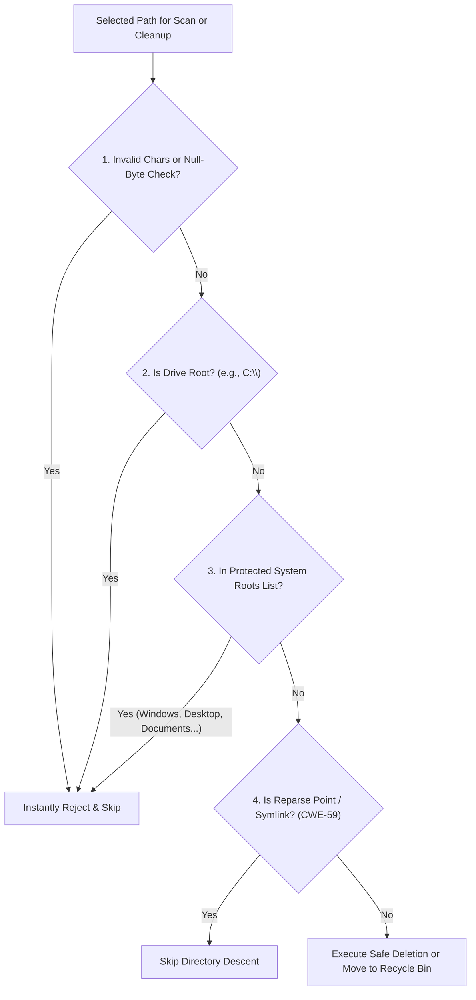

# 4. Security Model, OWASP Hardening, and Safety Guards (Security & Protection)

Executing file deletions at the operating system level is one of the highest-risk operations a desktop application can perform. A minor path resolution flaw or blindly traversing symbolic links could wipe essential Windows binaries or eradicate user personal data.

Pakban adopts a strict **Security by Design** philosophy, conforming rigorously to the **OWASP Desktop Application Security Project** and **Microsoft Secure Coding Guidelines**.

---

## 4.1. Defensive Validation Pipeline



---

## 4.2. Path Traversal Defense (CWE-22)

In unhardened cleaners, path traversal flaws or manipulated environment variables could cause file operations to escape target folders into sensitive directories.

### Implemented Defenses in Pakban:
1. **Protected System Roots Blacklist (`ProtectedSystemRoots`):**  
   During static initialization, `FileOps` locks a canonicalized blacklist of vital OS and user roots in memory:
   - Operating system root (`%WINDIR%`)
   - 32-bit and 64-bit system binaries (`System32`, `SysWOW64`)
   - Standard application installation directories (`Program Files`, `Program Files (x86)`)
   - Root user profile folder (`C:\Users`)
   - Personal directories: User Profile root, `Desktop`, `Documents`, and system libraries.
2. **Drive Root Deletion Barrier:**  
   Passing any bare drive root (such as `C:\` or `D:\`) to `FileOps.IsPathSafeForCleanup` evaluates to `false`, forbidding root-level operations.
3. **Null-Byte Injection & Illegal Character Scrubbing:**  
   Paths containing control characters, illegal Win32 path symbols, or embedded `\0` bytes are immediately rejected before touching the filesystem.

```csharp
// Excerpt from FileOps.cs:
if (Path.GetPathRoot(fullPath)?.Equals(fullPath, StringComparison.OrdinalIgnoreCase) == true)
{
    // Stripping bare disk roots is forbidden
    return false;
}
if (ProtectedSystemRoots.Any(p => fullPath.Equals(p, StringComparison.OrdinalIgnoreCase)))
{
    // Access to protected operating system roots is forbidden
    return false;
}
```

---

## 4.3. Symbolic Link & Junction Point Mitigation (CWE-59)

One of the most dangerous attack vectors on Windows involves NTFS Directory Junctions and Symbolic Links. If an unprivileged user or malicious process places a junction inside `%TEMP%` pointing to `C:\Windows\System32`, an elevated cleaner traversing that folder could destroy critical operating system files.

### Pakban's Defensive Measures:
- **Reparse Point Detection without Link Traversal:**  
  `FileOps.IsReparsePoint(path)` utilizes `File.GetAttributes(path)` to inspect NTFS metadata directly. It verifies the presence of `FileAttributes.ReparsePoint` without resolving or following the target.
- **Safe Directory Enumeration:**  
  In `StorageScannerService`, recursive discovery explicitly instructs the .NET file system enumerator to ignore reparse points:
  ```csharp
  private static readonly EnumerationOptions SafeEnumOptions = new()
  {
      RecurseSubdirectories = true,
      IgnoreInaccessible = true,
      AttributesToSkip = FileAttributes.ReparsePoint // Never follow links or junctions
  };
  ```
- **Symlink Destruction Safety:**  
  When cleaning temporary files, junction points are either skipped or unlinked at the junction node itself, guaranteeing that the external destination directory remains entirely untouched.

---

## 4.4. Mitigating Time-of-Check to Time-of-Use (TOCTOU) Races

A race condition occurs if an item is verified safe during an initial scan, but is replaced by a symbolic link before deletion begins.
- Pakban re-validates attributes immediately prior to executing any destructive file operation, ensuring path integrity is verified at the exact moment of execution.

---

## 4.5. Fault-Tolerant Handling of Locked Files & Sharing Violations

Active processes frequently hold open handles on cache databases and temporary files.
- Pakban wraps individual file deletions in specialized exception traps, safely absorbing `IOException`, `UnauthorizedAccessException`, and Win32 status codes `ERROR_SHARING_VIOLATION (32)` and `ERROR_LOCK_VIOLATION (33)`.
- When an in-use file is encountered, Pakban notes the occurrence in the diagnostic log, skips the file gracefully, and proceeds without interrupting the overall cleanup pipeline.

---

## 4.6. Recoverable Recycle Bin Integration

For higher-risk categories—specifically orphaned application leftovers and previous OS upgrades (`Windows.old`)—Pakban enforces a reversible deletion strategy.

Instead of calling permanent deletion APIs, Pakban delegates to the Windows Shell API `SHFileOperationW` with `FOF_ALLOWUNDO`:

```csharp
var shf = new SHFILEOPSTRUCT
{
    wFunc = FO_DELETE,
    pFrom = path + "\0\0",
    fFlags = FOF_ALLOWUNDO | FOF_NOCONFIRMATION | FOF_SILENT | FOF_NOERRORUI
};
SHFileOperation(ref shf);
```

This guarantees that files are safely transferred to the Windows Recycle Bin, giving users complete autonomy to restore items if an uninstalled application's configuration is needed later.

---

## 4.7. Privilege Elevation and Least Privilege (UAC)

- In accordance with the **Principle of Least Privilege**, Pakban runs as a standard user process by default.
- Categories that strictly require elevated administrative privileges (e.g., Windows Update Cache, Prefetch, System Logs) are marked with an administrative shield badge (`NeedsAdmin`).
- When elevated access is desired, users can trigger the **Restart as Administrator** action with one click, prompting the standard Windows User Account Control (UAC) consent dialog via the `runas` process verb.
