# ۳. معماری فنی و طراحی سیستم (Technical Architecture & Design)

نرم‌افزار پاکبان بر اساس استانداردهای روز مهندسی نرم‌افزار، بر پایه الگوی **MVVM (Model-View-ViewModel)** و با هدف دستیابی به بالاترین کارایی، ماژولار بودن، قابلیت نگهداری و تست‌پذیری پیاده‌سازی شده است.

---

## ۳.۱. پشته فناوری (Technology Stack)

- **زبان برنامه‌نویسی:** C# (نسخه مدرن با قابلیت‌های C# 12/13/14 نظیر Records، Pattern Matching، Nullable Reference Types).
- **چارچوب رابط کاربری:** Windows Presentation Foundation (WPF) بر بستر **.NET 10 (net10.0-windows)**.
- **الگوی طراحی:** MVVM همراه با `INotifyPropertyChanged`، رویدادها، و فرمان‌های نوع `RelayCommand`.
- **ارتباط با سیستم‌عامل (OS Interop):** تعامل مستقیم از طریق P/Invoke با Win32 APIs (`psapi.dll`, `shell32.dll`, `kernel32.dll`).
- **مدیریت وقایع و لاگ‌ها (Logging):** فریم‌ورک قدرتمند ساختاریافته **Serilog** با رولینگ روزانه و مدیریت کرش‌های سراسری.
- **پردازش غیرهمگام (Async/Await):** تفکیک کامل عملیات ورودی/خروجی دیسک (I/O Bound) و محاسبات سنگین (CPU Bound) از رشته اصلی رابط کاربری (UI Thread) از طریق `Task.Run` و `CancellationToken`.

---

## ۳.۲. نمودار معماری کلان سیستم (High-Level Architecture)

```mermaid
graph TD
    subgraph UI_Layer ["لایه رابط کاربری (Views & Controls)"]
        MainWindow["MainWindow.xaml"]
        DashboardPage["DashboardPage.xaml"]
        CleanerPage["CleanerPage.xaml"]
        RamPage["RamPage.xaml"]
        SettingsPage["SettingsPage.xaml"]
        CustomControls["Controls: DonutChart, LineChart, PercentBar"]
    end

    subgraph MVVM_Layer ["لایه مدل دید (ViewModels)"]
        MainVM["MainViewModel"]
        DashboardVM["DashboardViewModel"]
        CleanerVM["CleanerViewModel"]
        RamVM["RamViewModel"]
        SettingsVM["SettingsViewModel"]
        ScannerVM["StorageScannerViewModel"]
    end

    subgraph Services_Layer ["لایه سرویس‌های هسته (Services & Core Logic)"]
        ScannerService["StorageScannerService (IStorageScanner)"]
        CleanupService["CleanupService (ICleanupService)"]
        FileOps["FileOps (Low-level & Security Guard)"]
        OrphanDetect["OrphanDetection (Registry & Cache Scan)"]
        RamSvc["RamService (Win32 Memory Interop)"]
        ThemeMgr["ThemeManager & Palette"]
        LocEngine["Loc Engine (Dynamic RTL / Localization)"]
        LogSvc["LoggingService (Serilog Daily Rotating)"]
    end

    subgraph OS_Layer ["لایه سیستم‌عامل ویندوز (Windows Native Layer)"]
        NTFS["NTFS File System & Reparse Points"]
        ShellAPI["Shell32 API (SHFileOperationW / Recycle Bin)"]
        KernelPSAPI["Kernel32 / PSAPI (EmptyWorkingSet & Ram Stats)"]
        Registry["Windows Registry (Uninstall keys)"]
    end

    UI_Layer --> MVVM_Layer
    MVVM_Layer --> Services_Layer
    Services_Layer --> OS_Layer
```



---

## ۳.۳. ساختار درختی پروژه و تفکیک مسئولیت‌ها

پروژه به صورت کامپکت و تفکیک‌شده طراحی شده است:

```
Pakban/
├── Assets/                 # آیکون‌ها، تصاویر و فونت اختصاصی وزیرمتن (Vazirmatn.ttf)
├── Controls/               # کنترل‌های برداری سفارشی با متد OnRender اختصاصی
│   ├── DonutChart.cs       # نمودار دایره‌ای دونات انیمیشنی برداری
│   ├── LineChart.cs        # نمودار خطی بلادرنگ ۹۰ ثانیه‌ای مصرف رم
│   └── PercentBar.cs       # نوار درصدی رنگی با پالت گرادیان
├── Localization/           # سیستم محلی‌سازی و مدیریت جهت راست‌به‌چپ
│   ├── Loc.cs              # دیکشنری دوزبانه پویا و ایندکسر با قابلیت Refresh
│   ├── Flow.cs             # مدیریت FlowDirection در رابط کاربری
│   └── Bindings.cs         # افزونه‌های نشانه‌گذاری XAML برای بایندینگ ساده
├── Models/                 # مدل‌های داده و رکوردهای وضعیت
│   └── Models.cs           # تعریف CleanCategory, OrphanItem, CleanKind
├── Services/               # سرویس‌های زیرساخت و ارتباط با سیستم‌عامل
│   ├── FileOps.cs          # گارد امنیتی فایل‌ها، اعتبارسنجی مسیر، پاکسازی
│   ├── StorageScannerService.cs # اسکن ناهمگام دیسک و دسته‌بندی زباله‌ها
│   ├── CleanupService.cs   # موتور حذف ایمن فایل‌ها و ارتباط با سطل زباله
│   ├── OrphanDetection.cs  # موتور کشف داده‌های رها شده نرم‌افزارهای حذف شده
│   ├── RamService.cs       # مانیتورینگ رم و اجرای WorkingSet Trim
│   ├── SettingsService.cs  # ذخیره و بازیابی تنظیمات با فرمت JSON
│   ├── ThemeManager.cs     # اعمال پویا تم‌های Dark/Light
│   ├── Palette.cs          # پالت‌های رنگی و Accentها
│   ├── LoggingService.cs   # پیکربندی Serilog و چرخه لاگ‌ها
│   └── UiDialogs.cs        # کادرهای پیام و تاییدیه‌های سفارشی
├── Themes/                 # قالب‌های بصری XAML
│   ├── Dark.xaml           # طراحی تیره مدرن
│   └── Light.xaml          # طراحی روشن هماهنگ
├── ViewModels/             # پیاده‌سازی منطق ارائه داده‌ها بر اساس MVVM
│   ├── ViewModelBase.cs    # کلاس پایه حاوی رویداد NotifyPropertyChanged
│   ├── MainViewModel.cs    # مدیریت نوار ناوبری و وضعیت پنجره اصلی
│   ├── DashboardViewModel.cs # تجمیع اطلاعات پیشخوان
│   ├── CleanerViewModel.cs # هدایت فرآیند اسکن و پاکسازی دیسک
│   ├── RamViewModel.cs     # تایمر و واکشی مداوم مصرف حافظه
│   └── SettingsViewModel.cs# تعامل با کاربر برای تغییر زبان، تم و تنظیمات
├── Views/                  # صفحات و پنجره‌های XAML
│   ├── MainWindow.xaml     # پنجره بی حاشیه (Borderless) سفارشی
│   ├── DashboardPage.xaml  # ویجت‌های پیشخوان
│   ├── CleanerPage.xaml    # نمای دسته‌بندی‌ها و درخت اسکن
│   ├── RamPage.xaml        # نمای پایش و بهینه‌سازی رم
│   └── SettingsPage.xaml   # تنظیمات برنامه
├── App.xaml / App.xaml.cs  # چرخه حیات برنامه، ثبت وقایع خطای عمومی
├── app.manifest            # مانیفست Per-Monitor DPI و سازگاری با Long Path
└── Pakban.csproj           # فایل پیکربندی پروژه .NET 10
```

---

## ۳.۴. مهندسی رابط کاربری (Modern UI Engineering)

### ۳.۴.۱. پنجره سفارشی بدون حاشیه با WindowChrome
برای حذف ظاهر خسته‌کننده نوار عنوان سنتی ویندوز و در عین حال حفظ تمام رفتارهای طبیعی سیستم‌عامل (Aero Snap، حرکت روان پنجره، Resize در لبه‌ها و پشتیبانی از دو بار کلیک جهت ماکسیمایز)، از کلاس بومی `System.Windows.Shell.WindowChrome` استفاده شده است:

```xml
<WindowChrome.WindowChrome>
    <WindowChrome GlassFrameThickness="0"
                  CornerRadius="0"
                  CaptionHeight="40"
                  ResizeBorderThickness="6"
                  UseAeroCaptionButtons="False" />
</WindowChrome.WindowChrome>
```

### ۳.۴.۲. مدیریت پویا تم و رنگ‌های شاخص (Dynamic Theming)
برنامه از منابع `ResourceDictionary` ادغام‌شده (`MergedDictionaries`) بهره می‌برد. هنگام تغییر تم توسط کاربر:
1. دیکشنری تم قدیمی از `Application.Current.Resources.MergedDictionaries` حذف می‌شود.
2. دیکشنری تم جدید (`Dark.xaml` یا `Light.xaml`) جایگزین می‌گردد.
3. مقادیر `SolidColorBrush` مربوط به رنگ‌های تاکیدی (Accent Colors) به صورت آنی در حافظه به‌روزرسانی شده و تمام کنترل‌ها بدون نیاز به بازسازی پنجره به‌روز می‌شوند.

### ۳.۴.۳. معماری محلی‌سازی و پشتیبانی دوطرفه از RTL/LTR
موتور محلی‌سازی `Loc.cs` از الگوی Singleton با پیاده‌سازی `INotifyPropertyChanged` استفاده می‌کند:
- تمام رشته‌های متنی به صورت ایندکسر (`{Binding [key], Source={x:Static loc:Loc.I}}`) بایند شده‌اند.
- با فراخوانی متد `SetLanguage("fa")`، خاصیت `Binding.IndexerName` اطلاع‌رسانی شده و تمامی متون سراسر برنامه در همان لحظه ترجمه می‌شوند.
- همزمان، ویژگی `FlowDirection` کل پنجره بر اساس مقدار `IsRtl` بین `RightToLeft` و `LeftToRight` جابجا می‌شود.
- در زبان فارسی، فونت به صورت پویا به فونت تعبیه‌شده **وزیرمتن** (`pack://application:,,,/Assets/Fonts/#Vazirmatn`) سوئیچ می‌کند تا خوانایی متون به حداکثر برسد.

---

## ۳.۵. بهینه‌سازی رندرینگ در کنترل‌های سفارشی (Custom OnRender)

برای جلوگیری از سنگینی و افت فریم ناشی از استفاده از کتابخانه‌های حجیم جانبی نمودار، کنترل‌های `DonutChart` و `LineChart` به صورت اختصاصی با اورراید کردن متد `OnRender(DrawingContext dc)` پیاده‌سازی شده‌اند:
- **محاسبات هندسی دقیق با Direct Drawing:** ترسیم خطوط، قطاع‌های دایره و گرادیان‌ها مستقیماً با استفاده از `StreamGeometryContext` و `DrawingContext` انجام می‌شود.
- **استفاده از شتاب‌دهنده گرافیکی (Hardware Acceleration):** با انجماد براش‌ها (`brush.Freeze()`) و حداقل‌سازی بازتولید ساختارهای بصری (Visual Elements)، رندر نمودار با نرخ ۶۰ فریم بر ثانیه و نزدیک به صفر درصد مصرف CPU انجام می‌پذیرد.
