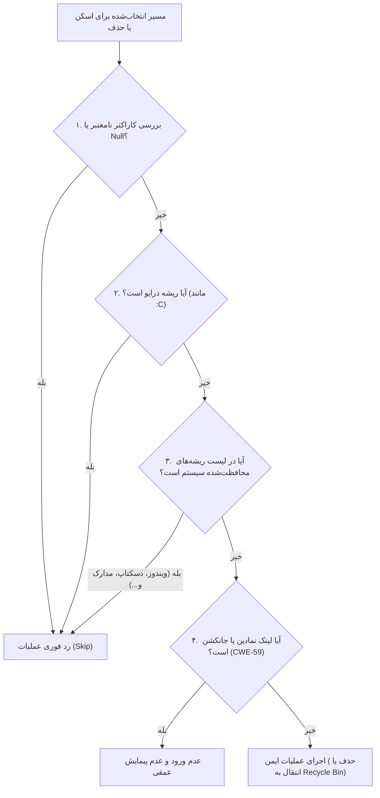

# ۴. مدل امنیت، استانداردها و مکانیزم‌های حفاظتی (Security & Protection)

پاکسازی فایل‌ها در سطح سیستم‌عامل، یکی از حساس‌ترین و پرمخاطره‌ترین عملیات نرم‌افزاری است. یک اشتباه کوچک در حل کردن آدرس مسیر یا پیروی کورکورانه از لینک‌های نمادین، می‌تواند منجر به پاک شدن فایل‌های حیاتی ویندوز یا اطلاعات شخصی کاربر شود.

نرم‌افزار پاکبان با رویکرد **امنیت بر اساس طراحی (Security by Design)** و انطباق کامل با دستورالعمل‌های **OWASP Desktop Application Security Project** و **Microsoft Secure Coding Guidelines** مهندسی شده است.

---

## ۴.۱. ماتریس تدابیر امنیتی و پیشگیری از آسیب‌پذیری‌ها



---

## ۴.۲. مقابله با آسیب‌پذیری پیمایش مسیر (CWE-22: Path Traversal)

در نرم‌افزارهای پاکسازی، حملات یا خطاهای Path Traversal می‌توانند باعث شوند دستورات حذف به شاخه‌های بالادستی (مانند `C:\Windows` یا پوشه `Users`) نشت پیدا کنند.

### راهکارهای پیاده‌سازی شده در پاکبان:
1. **لیست سیاه سخت‌گیرانه مسیرهای سیستمی (`ProtectedSystemRoots`):**  
   کلاس `FileOps` در بدو راه‌اندازی، لیستی از حساس‌ترین شاخه‌های سیستم‌عامل را در حافظه قفل می‌کند:
   - پوشه اصلی ویندوز (`%WINDIR%`)
   - پوشه سیستمی ۳۲ بیتی و ۶۴ بیتی (`System32`, `SysWOW64`)
   - پوشه برنامه‌های نصب‌شده (`Program Files`, `Program Files (x86)`)
   - ریشه دایرکتوری تمامی کاربران (`C:\Users`)
   - پروفایل شخصی کاربر جاری (`UserProfile`)
   - دسکتاپ (`Desktop`)، اسناد (`Documents`) و دانلودهای اصلی کاربر
2. **بررسی عدم وجود ریشه خالی (Drive Root Check):**  
   حذف مستقیم هر درایوی (نظیر `C:\` یا `D:\`) در متد `IsPathSafeForCleanup` صراحتاً مسدود شده است.
3. **اعتبارسنجی کاراکترهای مخرب و بایت تهی (Null-Byte Injection):**  
   هر مسیری که حاوی کاراکترهای کنترلی، کاراکترهای غیرمجاز ویندوز یا `\0` باشد فوراً رد می‌شود.

```csharp
// نمونه کد از FileOps.cs:
if (Path.GetPathRoot(fullPath)?.Equals(fullPath, StringComparison.OrdinalIgnoreCase) == true)
{
    // حذف ریشه دیسک اکیداً ممنوع است
    return false;
}
if (ProtectedSystemRoots.Any(p => fullPath.Equals(p, StringComparison.OrdinalIgnoreCase)))
{
    // دسترسی به دایرکتوری‌های حساس سیستم ممنوع است
    return false;
}
```

---

## ۴.۳. مقابله با حملات لینک‌های نمادین و جانکشن‌ها (CWE-59: Reparse Point / Symlink Traversal)

یکی از خطرناک‌ترین بردار‌های حمله در سیستم‌عامل ویندوز، استفاده از NTFS Directory Junctions یا Symbolic Links است. اگر یک نرم‌افزار تمیزکننده بدون احتیاط وارد یک Symlink در پوشه Temp شود که به `C:\Windows\System32` اشاره می‌کند، تمام فایل‌های داخل دایرکتوری مقصد حذف خواهند شد!

### سازوکار دفاعی پاکبان:
- متد اختصاصی `FileOps.IsReparsePoint(path)` با خواندن مستقیم متادیتاهای NTFS (`File.GetAttributes(path)`) بدون پیمایش و دنبال کردن هدف لینک، تشخیص می‌دهد که آیا پوشه یا فایل مورد نظر یک Reparse Point است یا خیر.
- در کلاس `StorageScannerService`، گزینه پیمایش امن تعریف شده است:
  ```csharp
  private static readonly EnumerationOptions SafeEnumOptions = new()
  {
      RecurseSubdirectories = true,
      IgnoreInaccessible = true,
      AttributesToSkip = FileAttributes.ReparsePoint // نادیده گرفتن قطعی تمام Symlinkها
  };
  ```
- هنگام حذف فایل‌های موقت، هرگز به داخل پوشه‌هایی که ماهیت لینک دارند نفوذ نمی‌شود و در صورت نیاز تنها خود شیء لینک حذف می‌شود، نه محتوای هدف لینک در جای دیگر دیسک.

---

## ۴.۴. مقابله با شرایط رقابتی زمان بررسی تا استفاده (TOCTOU: Time-of-Check to Time-of-Use)

بین زمانی که نرم‌افزار بررسی می‌کند یک فایل "فایل موقت مجاز" است و زمانی که اقدام به حذف آن می‌کند، ممکن است پردازه دیگری پوشه را با یک لینک نمادین جایگزین کند.
- پاکبان با بررسی مجدد ویژگی‌های فایل (`FileAttributes`) درست پیش از صدور دستور حذف، از بروز خطاهای ناشی از TOCTOU پیشگیری می‌نماید.

---

## ۴.۵. مدیریت فایل‌های قفل‌شده و خطاهای دسترسی (Sharing Violations & Locked Files)

فایل‌های سیستم و فایل‌های موقت مرورگرها ممکن است هم‌اکنون توسط برنامه‌های دیگر باز باشند.  
- پاکبان از بروز هرگونه Crash ناشی از استثناهای `IOException`, `UnauthorizedAccessException`, `SecurityException` یا خطا با کد وضعیت `ERROR_SHARING_VIOLATION (32)` و `ERROR_LOCK_VIOLATION (33)` جلوگیری می‌کند.
- فایل‌هایی که در لحظه توسط ویندوز یا نرم‌افزارهای فعال در حال استفاده هستند، با ثبت یک لاگ تشخیصی، نادیده گرفته شده و فرآیند پاکسازی بدون وقفه ادامه می‌یابد.

---

## ۴.۶. مکانیزم سطل بازیافت (Recycle Bin Safety Model)

برای دسته‌بندی‌هایی که احتمال خطای انسانی در آن‌ها وجود دارد (مانند داده‌های بازمانده برنامه‌های حذف شده و `Windows.old`)، پاکبان هرگز از دستور `File.Delete` مستقیم استفاده نمی‌کند.

در عوض، از طریق فراخوانی مستقیم API شل ویندوز `SHFileOperationW` با پرچم اختصاصی `FOF_ALLOWUNDO` فایل‌ها به سطل زباله سیستم‌عامل هدایت می‌شوند:

```csharp
var shf = new SHFILEOPSTRUCT
{
    wFunc = FO_DELETE,
    pFrom = path + "\0\0",
    fFlags = FOF_ALLOWUNDO | FOF_NOCONFIRMATION | FOF_SILENT | FOF_NOERRORUI
};
SHFileOperation(ref shf);
```

این مکانیزم تضمین می‌کند که حتی در صورت پشیمانی کاربر یا خطای تشخیصی، تمامی اطلاعات به راحتی از طریق Recycle Bin ویندوز قابل بازگردانی (Restore) خواهند بود.

---

## ۴.۷. مدیریت سطوح دسترسی (UAC & Principle of Least Privilege)

- پاکبان طبق اصل کمترین امتیاز (Least Privilege) نیازی به اجرای مداوم در حالت Administrator ندارد.
- دسته‌بندی‌هایی که برای اسکن و پاکسازی نیاز به دسترسی ادمین دارند (نظیر کش ویندوز، لاگ‌های سیستمی و Prefetch) با علامت یک قفل کوچک (`NeedsAdmin`) در رابط کاربری متمایز می‌شوند.
- در صورت نیاز کاربر به پاکسازی آن بخش‌ها، برنامه امکان **راه‌اندازی مجدد در حالت Administrator (Elevation)** را با یک کلیک و از طریق فراخوانی فرآیند جدید با Verb `runas` فراهم می‌کند.
